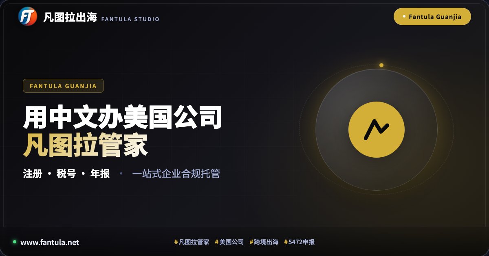
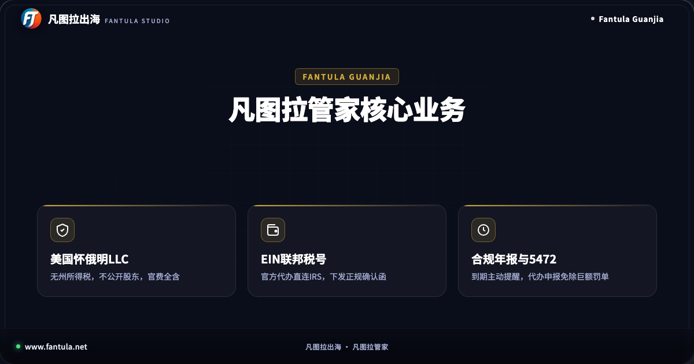
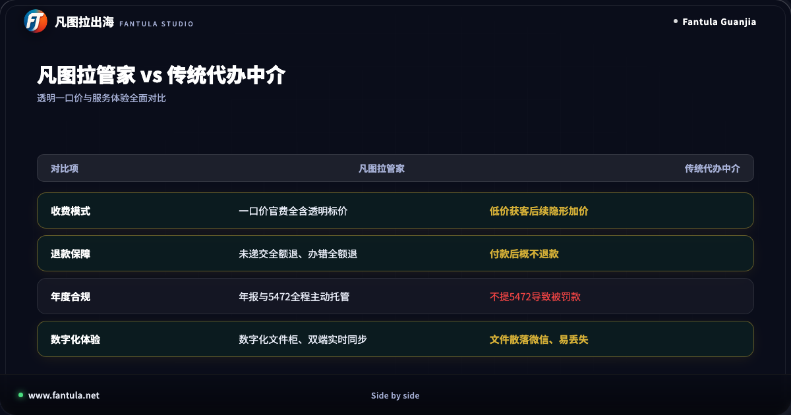
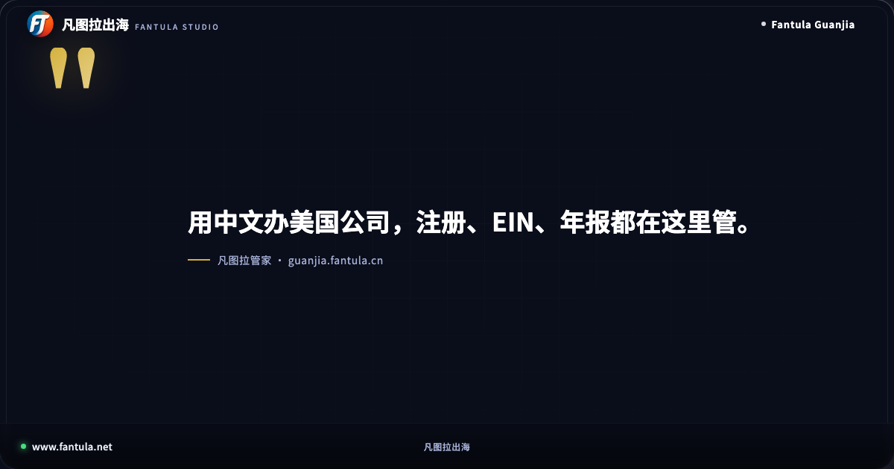
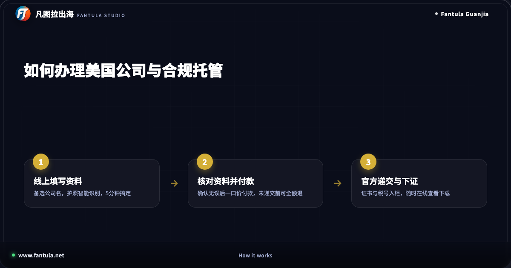

# 别再找黑中介！用中文办美国公司看这3步怎么做

## 一、为什么现在做跨境出海，都需要一家美国公司？

做独立站、跨境电商、海外软件开发或者数字游民的朋友，通常都会遇到这些坎：开通国际支付网关需要海外主体，申请海外企业开发者账号需要商业执照，入驻主流跨境平台或者与海外客户签署合同，同样绕不开一家正规的境外企业。

很多初次出海的创业者，往往在找代办中介时吃尽了苦头。市面上充斥着层层转包的代理机构：先用低价把人吸引进来，中途巧立名目不断加收各种加急费、查名费；办理完成后，相关的文件散落在聊天记录里，第二年找人续费时要么失联，要么面临翻倍的开价。更有甚者，对于至关重要的年度合规税务申报只字不提，导致企业在不知不觉中产生合规风险。

其实，设立一家合规的美国公司，流程本身完全可以做到清晰、透明、标准。

## 二、首选怀俄明州LLC：兼顾成本与隐私的优选方案

对于大多数不需要在美国本土招聘全职员工、主要从事跨境电商、软件开发与数字出海业务的团队来说，怀俄明州（Wyoming）设立有限责任公司（LLC）是非常务实的选择。

首先是税务与规费负担轻。怀俄明州不征收州企业所得税与个人所得税，每年的州政府年审规费在全美各州中也属于较低水平，长期维持的确定性非常高。

其次是信息保护机制完善。怀俄明州法律允许在州政府公开登记信息中不公开披露股东和成员的个人具体姓名，由法定注册代理负责日常法定联络，极大保护了创业者的个人资产安全与隐私。

最关键的是，非美国居民无需亲赴当地，全程在线使用中文准备材料即可办理，不需要绿卡，也不需要社安号，一本护照就能开启全球化经营的第一步。

## 三、告别套路：看清代办服务的三大核心标准

挑选出海企业代办服务，不能光看前期的口头承诺，必须紧盯三个硬指标：是否官费全含、年度合规是否闭环、售后退款机制是否敢白纸黑字写进协议。

### 1. 一口价全含，拒绝隐藏收费
正规的注册服务应当把州政府规费、查名核名、首年法定商业注册代理、法定收信地址以及中英双语运营协议一并包揽，明码标价，所见即所得。

### 2. 全年合规闭环托管
企业设立拿到证书只是起点。后续能否顺利申请到美国国税局的联邦税号，每年州年报是否能在截止日前按时申报，特别是外资单一成员涉及的年度税务报表，是否能够按期送达，直接决定了海外公司能不能长久稳健经营。

### 3. 明明白白的保障条款
真正专业的服务商敢于将退款机制写进协议：在向政府递交前如果改变主意可以全额退款；因审核不合规主动终止可以全额退款；遇到公司重名提供备选名免费重递；办错了负责到底并承担额外规费。

## 四、用中文办美国公司，只需简单三步

通过数字化平台办理美国公司，不再需要填写冗长复杂的全英文法律文书，整个流程已被梳理为清晰标准的三步。

* **第一步：在线填写企业基础信息**：在平台选定怀俄明州有限责任公司，准备备选公司英文名称，中文地址由系统智能翻译匹配，上传护照完成信息核对，几分钟即可完成填报。
* **第二步：核对清单并确认支付**：在核对页面对经营信息与申报选项进行全面确认，明细透明，一次性支付全流程费用。在向官方机构正式递交之前，随时享有全额退款保障。
* **第三步：官方审核下发与云端入柜**：专业团队完成材料制作与政府递交，下发的成立证书、联邦税号确认函等核心资产自动归入数字化文件柜，支持随时在线查看与下载。

出海是一场马拉松，工具和主体架构应当是支撑业务拓展的坚实基石，而不是消耗精力的烦恼源头。理清规则、避开暗坑，用规范、省心的方式扬帆起航。

---

> 原文：[别再找黑中介！用中文办美国公司看这3步怎么做](https://www.fantula.net)
