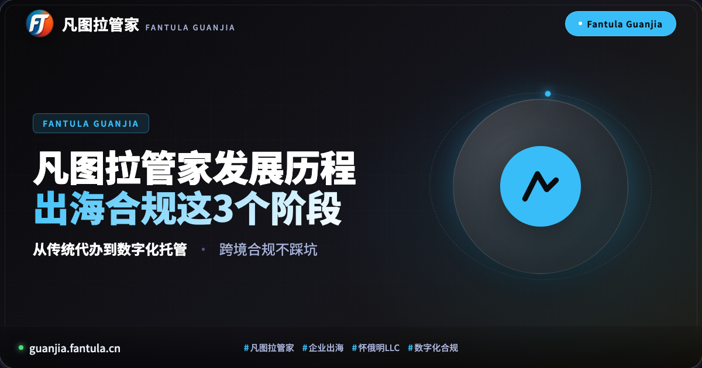
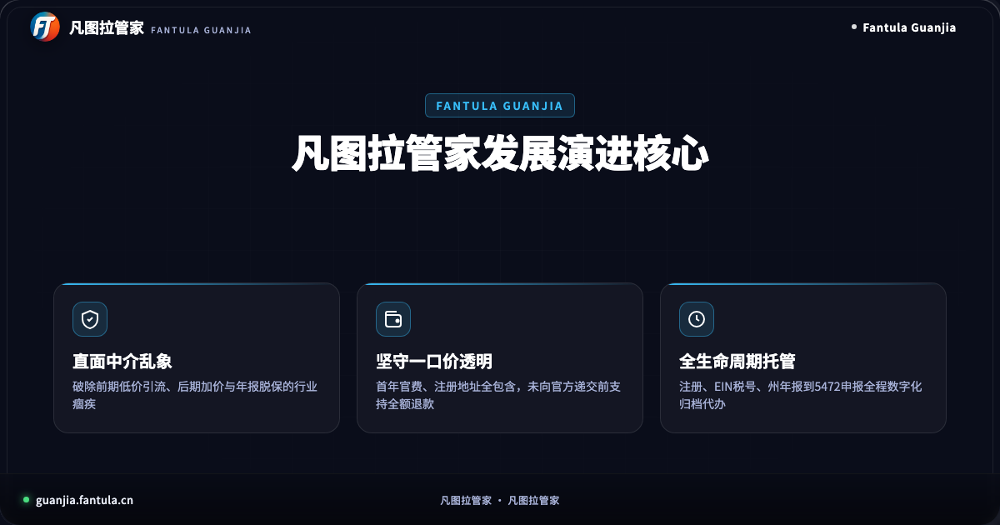
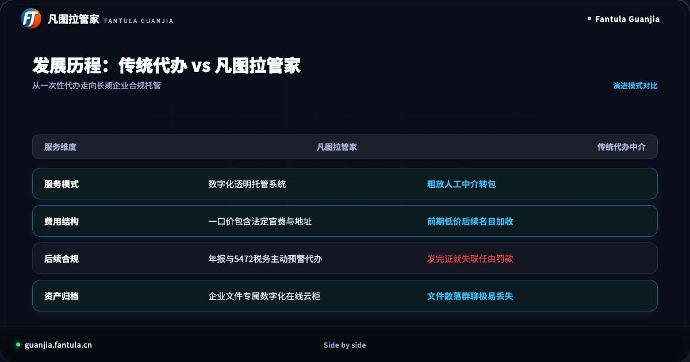
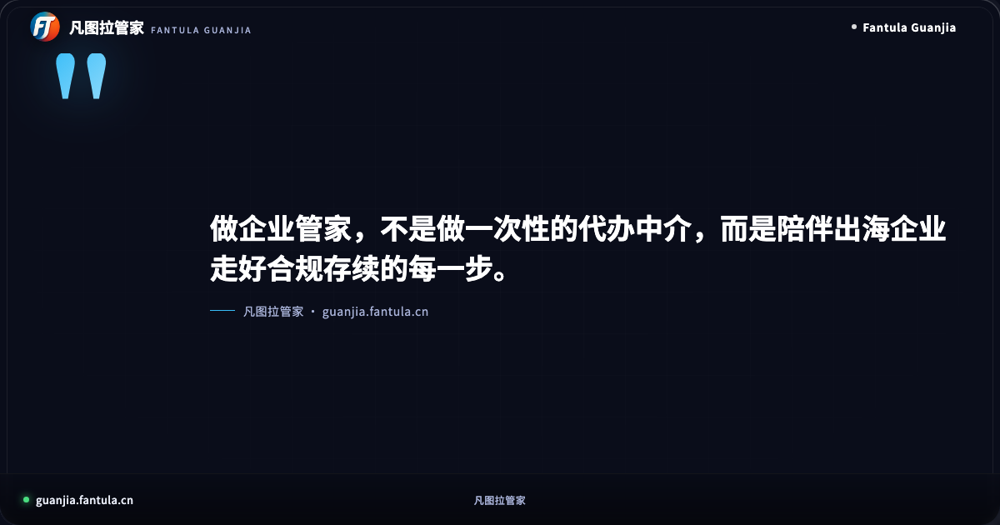
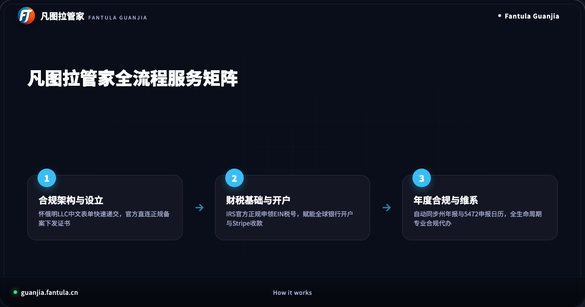

# 最新凡图拉管家发展历程：出海如何免踩坑？看这3个阶段

在全球商业高度互联的今天，中国品牌与数字化企业走向海外已经从一道“选择题”，变成了决定企业长远竞争力的“必答题”。无论是开展独立站全球收款、入驻海外主流电商平台，还是接入全球开发者与跨境技术生态，设立一家合法合规的美国怀俄明州公司（Wyoming LLC），都是跨境出海业务扬帆起航的重要基石。

然而，在过去很长一段时间里，跨境企业服务市场始终笼罩在信息不对称与服务断层的阴影之下。许多出海创业者在寻找服务商时常常陷入迷茫：前脚刚付完几百元的所谓“超低代办费”，后脚就遭遇注册地址费、年检费等层层隐形加价；好不容易拿到了官方营业执照，中介却在关键的税务合规环节彻底失联，导致企业在成立一年后突遭数万美元的高额罚单。

凡图拉管家正是在这样的行业背景下应运而生。回顾凡图拉管家的发展演进历程，其本质是一部中国出海企业服务从“粗放中介转包”走向“透明数字化合规托管”的进化史。本文通过深度拆解凡图拉管家发展历程的3个关键阶段，带广大出海创业者看清跨境企业设立的底层逻辑，掌握长治久安的合规避坑之道。

---

## 阶段一：行业痛点洞察与一口价理念确立，打破中介层层隐形加价

凡图拉管家的探索，始于对跨境代办行业乱象的深刻洞察。

在跨境电商与数字化出海爆发的早期，国内大部分出海企业在办理海外主体设立时，几乎只能依赖传统的中介代理机构。然而，传统中介代理模式存在着天然的弊端。绝大多数中介机构并不具备在美国本土直接对接州政府的能力，而是充当“二道贩子”，将客户需求层层转包给海外下游律所或代理，由此催生了严重的收费黑洞与沟通阻碍。

最典型的行业乱象就是“低价钓鱼，后期收割”。部分机构在各大平台打出远低于官方成本的虚假价格吸引眼球，等创业者签了合同、付了首款后，才发现连州政府的法定规费都需要另行追加。更有甚者，首年免费挂靠地址，次年便漫天要价数千元挂靠费，连接收一封州务卿的纸质合规信件都要单独加收高额服务费。出海企业原本为了降本增效，结果却在无休止的“补缴账单”中疲于奔命。

正因看到无数出海同胞在繁杂的中介套路中受挫，凡图拉管家在初创阶段便明确了核心底线：**坚守透明一口价，彻底杜绝隐形加价**。

凡图拉管家将美国怀俄明州有限责任公司（LLC）设立全流程进行全面标准化拆解。在服务方案中，明确把州政府法定注册规费、官方标准公司章程备案、首年正规合规注册代理人服务以及官方电子证书交付全部打包为一体化公开报价。所有费用在递交前一次性清晰罗列，做到中途绝无任何名目的二次收费。

更重要的是，凡图拉管家在业内率先推出了前置退款保障制度：在向美国州政府官方系统正式提交资料之前，客户若因自身业务方向调整，均可享有全额退款保障。这一机制不仅给创业团队提供了极大的资金安全感，也倒逼服务团队把精力全部倾注在服务质量与交付速度上。

---

## 阶段二：从粗放人工沟通到数字化系统，建立标准化透明作业闭环

进入第二发展阶段，凡图拉管家将重心放在了服务体验的数字化重构上。

在传统中介模式下，客户办业务主要通过即时通讯小群对接数位客服。这种方式虽然看似便捷，但背后潜藏着巨大的管理隐患：客户提交的股东证件、护照扫描件、注册信息往往散落在繁杂的聊天记录里，不仅面临隐私泄露风险，还极易因客服人员离职而导致历史档案彻底遗失；办证进度全凭客户在群里反复催问，企业负责人完全无法直观了解当前处于哪个审批节点。

办一家正规的海外公司，不应是一场碰运气的黑盒操作，而应是一套严密、透明、高效的标准化工程。

为此，凡图拉管家全面摒弃了手工作坊式的中介对接，自主研发搭建了专属的数字化管家托管服务平台。

通过数字化架构升级，凡图拉管家为出海企业带来了三大维度的体验革新：
1. **中文直观交互表单**：全中文结构化引导界面，将原本复杂的英文法律用语转化为通俗易懂的选择填报项，创业者只需按照提示填写基础信息，系统前端即可自动完成合规校验与英文命名规范检查；
2. **州系统直连与进度透明**：平台与美国官方系统通道规范对接，实时同步申请受理、核名流转、执照批准等各个节点状态，用户登录控制台即可对办理进度了如指掌，彻底告别“催客服、等回音”的焦虑；
3. **数字化文件云柜长期归档**：公司执照下发后，官方注册证书、组织章程、首年法定代理凭证等全套法律文本会自动归档入库。企业在后续开展海外银行开户、接入第三方跨境网关或申请商标时，均可随时随地一键查阅下载，实现企业核心合规资产的安全沉淀。

---

## 阶段三：全生命周期合规托管成型，攻克5472申报与年报脱保死穴

随着越来越多中国企业步入出海深水区，凡图拉管家在陪伴客户成长的过程中，发现了一个更为致命的深层痛点：**重设立、轻合规，拿到执照后的合规断层**。

许多首次出海的创始人存在认知误区，误以为只要拿到注册证书，公司就一劳永逸了。但事实上，在美国商业合规体系中，设立公司仅仅是万里长征的第一步，后续持续的法定维护才是决定海外主体能否长期稳健存续的关键所在。

以出海企业最常设立的怀俄明州单成员有限责任公司（LLC）为例，企业成立后必须直面两大刚性合规义务：
- **美国国税局（IRS）年度信息申报**：针对由外籍人士完全控股的美国实体，IRS 强制要求每年提交 Form 5472 与 Form 1120 报告，详细披露跨境关联交易与实质控股信息。如果企业未能按期申报或漏报，根据美国税法规定，将面临单次最低高达 25,000 美元的法定罚款，这对于初创出海项目往往是难以承受的沉重打击；
- **州政府年度报告（Annual Report）法定备案**：怀俄明州要求公司每年在成立周年月之前完成年度备案并缴纳特许经营税。如果企业脱保逾期，州政府会在宽限期后直接将公司状态变更为“撤销”（Dissolved），不仅公司名下的银行账户会被立刻冻结，企业品牌信誉也将毁于一旦。

遗憾的是，传统中介大多只做“一锤子买卖”，在收取了注册费、交付了证书后便不再提供后续指引。很多出海老板往往在经营一两年后，突然收到来自美国税局的巨额罚缴通知书，才惊觉自己的公司早已处于非合规甚至被撤销的危险境地。

针对这一行业死穴，凡图拉管家在第三阶段完成了从“设立服务商”到“全生命周期企业管家”的根本蜕变。

凡图拉管家建立了完善的年度合规托管与主动预警体系：
- **EIN 联邦雇主税号合规代办**：不仅负责注册公司，更由合规团队直连 IRS 正规申领官方 EIN 确认函（CP 575），为后续开设商业账户、绑定第三方全球收款提供法理支撑；
- **全自动合规日历与主动预警**：系统自动为每家托管企业建立合规日历档案，在年报申报窗口期开启前主动启动预警与确认，专业合规人员统一对接州务卿系统完成公职特许备案；
- **5472 与跨境合规全链条支持**：依托成熟的跨境财税法务协同网络，为外资企业提供规范的 Form 5472 与税务申报指导代办，让出海企业彻底告别逾期漏报风险。

---

## 常见问题（FAQ）

### Q1：出海企业办理美国公司注册代理人该如何挑选？
挑选合规的美国注册代理人（Registered Agent）主要看三点：首先，必须在设立所在州拥有实体商业办公地址，能够常年代表企业正常接收州政府官方通知及法律诉讼文件；其次，收费模式必须公开透明，拒绝低价引入后在次年年审、地址续期和信件扫描上漫天要价；最后，服务商必须具备完善的数字化系统和长期运营能力，防止因中介倒闭或更换地址导致企业重要法律文件遗漏丢失。

### Q2：注册美国公司流程及费用有哪些必看要点？
流程上通常分为三步：核定英文公司名称并确认经营范围、向州务卿递交注册章程申请证书、向国税局申请 EIN 联邦税号。费用方面，一定要弄清报价是否包含官方收取的法定规费以及首年注册代理人地址费用。许多非正规机构看似报价低廉，但后续会把政府规费拆分成多项增值费用加收。凡图拉管家坚持一口价透明全含，确保创业者在办理之初就对总成本心中有数。

### Q3：凡图拉管家后续的年报与税务托管是如何运作的？
在凡图拉管家设立公司后，企业信息将直接纳入长期合规托管数据库。系统会根据公司的设立日期自动推算下一年度的年报周期，并在到期前由专属合规管家通过系统和正规通道主动发起维护提醒。整个年检备案由专业团队全权代办，完税及官方年报凭证实时沉淀至数字化云柜，真正帮助出海团队卸下繁琐的法务税务维护负担，将精力全面聚焦于海外市场的业务拓展。

---

出海创业是一场长跑，而合规是保障企业行稳致远的生命线。从破除隐形加价的初心，到构建透明的数字化系统，再到托底全生命周期的合规保障，凡图拉管家始终秉承用中文为中国创业者打通海外合规第一步的理念，陪伴每一个出海梦想坚实成长。

---

> 原文：[最新凡图拉管家发展历程：出海如何免踩坑？看这3个阶段](https://guanjia.fantula.cn)
