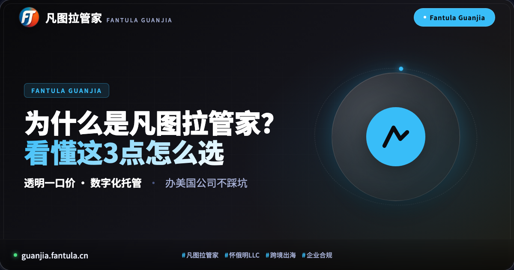
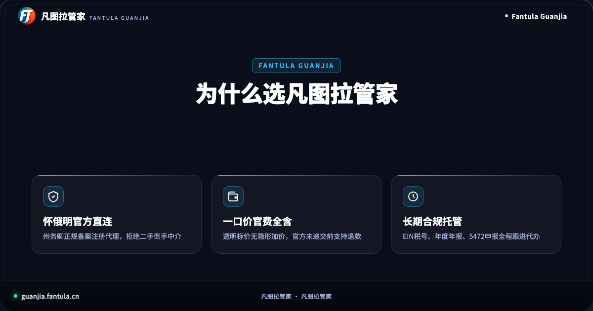
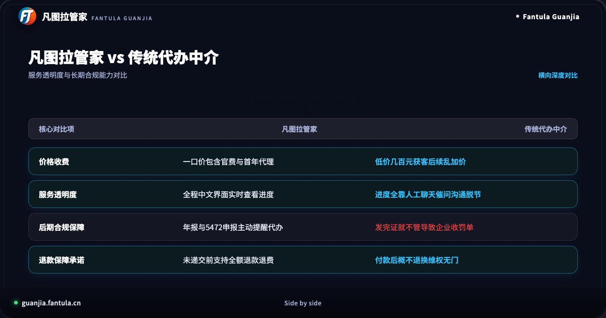
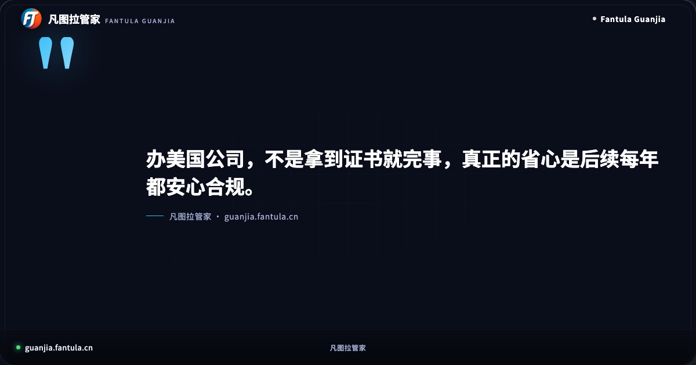
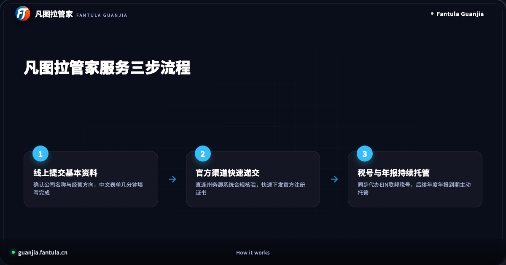

# 为什么是凡图拉管家？办美国公司看这3点怎么选

出海拓展全球业务，拥有一家合规的海外公司是迈向国际市场的第一步。无论是开展独立站全球收款、入驻海外主流电商平台，还是接入国际企业级技术服务，美国怀俄明州有限责任公司（LLC）都是跨境创业者的优选载体。

然而，面对鱼龙混杂的代理代办市场，很多出海创业者在选择服务机构时屡屡踩坑：有人被低价吸引，后续却遭遇地址费、年检费层层隐形加价；有人拿到执照后中介撒手不管，因漏报税务表格导致高额罚单。

办美国公司，为什么很多人最终选择了凡图拉管家？挑选代理机构到底该看什么？本文从价格透明度、长期合规托管与数字化服务能力三个核心维度，深度解析如何避开中介套路，选对靠谱的跨境企业管家。

---

## 维度一：价格透明度，拒绝“低价获客后续加价”

挑选注册代理机构，第一步要看的就是收费模式。

在传统的代办市场中，最常见的套路是“超低起步价”。某些机构在宣传时打出几百元的极低价格吸引客户，但一旦付款，后续的隐形收费便接踵而至：政府法定官费需要额外补交、首年注册代理人地址要单收高额租金、甚至连接收官方纸质信件都要按件收取服务费。原本以为省钱的方案，最终核算下来的总支出往往远超预期。

凡图拉管家从创立之初就坚持透明一口价原则。

在凡图拉管家，注册美国公司的费用明细公开透明，包含怀俄明州政府法定规费、首年合规注册代理人服务费、官方标准 Articles of Organization 备案以及电子证书交付。所有费用在递交前一次性列清，中途没有任何巧立名目的加价项目。

更重要的是，凡图拉管家建立了清晰的退款保障机制：在向州政府正式提交资料之前，客户若因业务调整改变主意，均支持全额退款。这种把规则摆在明面上的做法，真正保障了出海企业的资金安全与信任。

---

## 维度二：传统代办中介 vs 凡图拉管家深度对比

办美国公司不仅是一次性的文件提交，更是一套严谨的企业设立工程。传统中介与数字化管家服务究竟有何不同？我们可以通过以下核心维度进行横向对比：

从服务体验上看，传统代办机构多依赖人工即时通讯小群对接，客户提交资料后往往陷入漫长的等待，进度不透明、文件散落在聊天记录中极易丢失。一旦出现代办人员流动，历史文档更是无从查找。

凡图拉管家采用全流程数字化托管架构。出海企业从填写基本信息开始，便可通过清晰的中文交互界面完成全套操作。系统内嵌合规核验机制，实时同步州政府递交与审核进度。下发的正式证书、章程与凭证会自动归档至企业专属数字化文件柜，随时在线调取与下载，让企业资产管理井井有条。

---

## 维度三：长期企业合规，重在5472申报与年度年报托管

很多出海企业往往陷入一个误区，以为拿到注册证书和公司文件就大功告成。事实上，设立公司只是起点，后续的年度合规维护才是企业长期存续的关键。

在美国，针对由外籍人士完全控股的单成员有限责任公司（Foreign-Owned Single-Member LLC），美国国税局（IRS）有严格的信息申报要求。企业每年必须按时提交 Form 5472 及 Form 1120 进行关联交易与所有权信息披露。如果错过申报截止日期或漏报，将面临单次最低 25,000 美元的法定罚款，数额极其高昂。

不少传统代办中介为了促成前端销售，对后续繁琐的合规申报只字不提，甚至自身根本不具备专业处理跨境税务申报的能力。许多企业在成立一两年后突然收到税局催缴信，才发现因年报脱保导致公司被州政府撤销，面临巨大损失。

凡图拉管家将合规作为核心立足点。我们不仅协助企业合规设立怀俄明公司，更提供全生命周期的合规托管服务：
1. **EIN 联邦税号代办**：由专人对接美国国税局，合规申请官方 CP 575 或 147C 确认函，满足海外银行开户与第三方收款绑定的刚性需求；
2. **州政府年度报告托管**：系统在年报到期日前自动预警，由专业合规团队统一办理怀俄明州年度备案与公职特许经营税续期；
3. **5472 与年度合规申报支持**：标准化指导与申报代办，确保外资企业的法定申报环节无缝对接，彻底告别逾期罚单风险。

---

## 常见问题（FAQ）

### Q1：为什么出海企业普遍优先选择怀俄明州注册 LLC？
怀俄明州是美国 LLC 制度的发源地，其商事法律体系成熟稳定。怀俄明州不征收州企业所得税，没有个人所得税，且年度维护官费仅为固定的法定金额，整体维护成本极低。此外，怀俄明州充分保护企业成员隐私，公众查询系统中不强制公开股东与管理人员名单，非常适合跨境电商、技术出海与独立开发者。

### Q2：注册一家美国公司需要哪些准备材料？
通过凡图拉管家办理非常简便。您只需准备两到三个备选英文公司名称、主营业务简述，以及公司负责人的有效护照信息即可。全流程无需飞赴美国本土，无需繁琐的海外公证，全程线上即可高效完成。

### Q3：拿到公司证书后，后续还需要做些什么？
公司证书下发后，核心是两件事：一是申请 EIN 联邦税号，用于后续开设商业账户、绑定 Stripe 等全球收款工具；二是建立年度合规日历，按时完成怀俄明州年报和 IRS 5472 表格申报。凡图拉管家会为您全程做好到期提醒与代办托管，让企业把全部精力专注于出海业务增长本身。

---

办一家正规的美国公司并不复杂，关键在于选对省心、透明且具备长期合规服务能力的伙伴。凡图拉管家，用中文为您打通海外合规第一步。

---

> 原文：[为什么是凡图拉管家？办美国公司看这3点怎么选](https://guanjia.fantula.cn)
